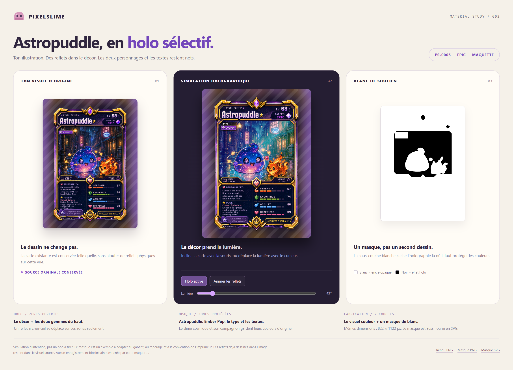
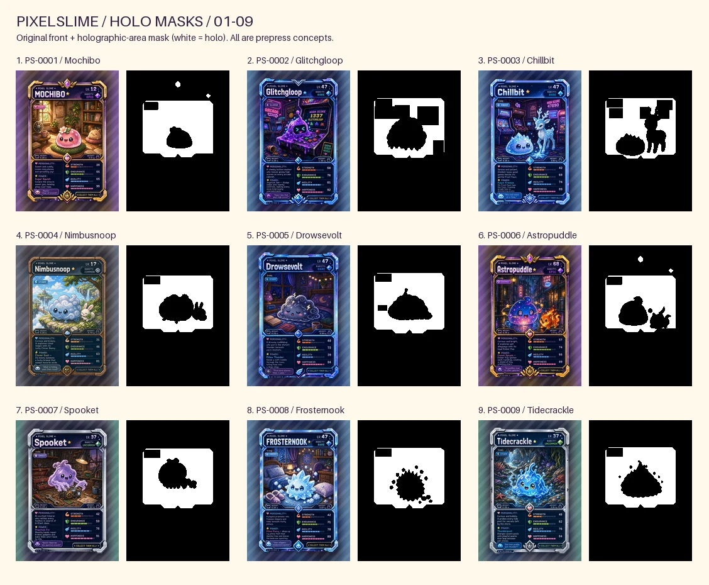

# PixelSlime Cards - Selective Holography

**36 complete card folders: front, matching back, holographic-area mask and opaque-white mask.**
This is the same **PS-0001 to PS-0033 + three bonus cards** snapshot as
[PixelSlime Cards](../cards/README.md), with editable, individually outlined foil placement.

> **Prepress concepts, not a printer-approved production master.**
> The front/back artwork is copied without modification. The masks express the intended finish;
> their contours, registration, minimum details and template must be approved by the chosen printer.
> They do not certify physical uniqueness or create any new blockchain record.



## What is included

Each numbered folder in [`cards`](cards) contains:

| File | Purpose |
|---|---|
| `front.png` | Original full-colour front, unchanged |
| `back.png` | Original matching back, unchanged, with its existing QR where present |
| `holo-mask.png` / `holo-mask.svg` | The areas intended to show holographic reflections |
| `white-ink-mask.png` / `white-ink-mask.svg` | The exact inverse: areas requiring an opaque white undercoat |
| **`qpmn-white-layer-mask.png` / `.svg`** | **Provider-labelled mask with QPMN's documented polarity: black = opaque white ink** |
| `preview.webp` | Front/back/mask side by side, for inspection only |

For example:

```text
cardsholo/
  cards/
    001-PS-0001-Mochibo/
      front.png
      back.png
      holo-mask.png
      holo-mask.svg
      white-ink-mask.png
      white-ink-mask.svg
      qpmn-white-layer-mask.png
      qpmn-white-layer-mask.svg
      preview.webp
    ...
    036-BONUS-03-Verify-Your-Slime/
  mockups/
    mochibo/
    astropuddle/
  previews/
  mask-definitions.json
  manifest.csv
  scripts/build.py
```

[`manifest.csv`](manifest.csv) gives the exact order, card ID, display title, source title,
rarity, existing profile URL, file paths, original image SHA-256 hashes and foil coverage.
All masks are labelled `concept-awaiting-prepress`; none is silently represented as factory-approved.

## The two mask conventions

**The two generic conventions are opposites. Upload only the convention requested by the printer,
not multiple masks as separate printing passes.**

| File family | White pixels | Black pixels |
|---|---|---|
| `holo-mask.*` | Holographic effect is visible here | No holographic effect here |
| `white-ink-mask.*` | Print opaque white under the colour artwork | Leave the foil visible through the colour artwork |
| **`qpmn-white-layer-mask.*`** | **No white ink: holographic effect is visible** | **Print opaque white ink: no holographic effect** |

The QPMN PNG is deliberately byte-identical to `holo-mask.png`, but labelled for the provider's
**white-ink pass**, not an additional foil pass. **Do not send `white-ink-mask.*` to QPMN unchanged:**
its polarity is the opposite. The QPMN SVG carries the provider-specific explanation as well.

The PNG masks contain only black and white, with no transparency or grey levels.
The SVG masks contain the same editable geometry. Both use the complete front canvas, including bleed,
so they must remain registered with `front.png`.

On holographic stock, the white ink hides the reflective material where the card must remain opaque.
The colour artwork is then printed over it. This is different from a glossy varnish and from simply
printing an image of a rainbow. Reflections already drawn into the original artwork are retained;
the physical foil adds a separate, light-dependent effect.

Supply **the convention requested by the printer**. A provider may call its mask "white", "spot white",
"underbase" or "foil", and may assign black/white differently. Confirm its interpretation rather than
renaming or inverting files by assumption.

QPMN's guide calls for **100% K black** to designate white ink. These monochrome PNG/SVG exports
encode the geometry and polarity; they are not a pre-separated CMYK/spot-colour production PDF.
Have its prepress team prepare or confirm the required K-only/white separation.

### Front-only finish

- Released slimes: selected illustration backgrounds and, where applicable, decorative gems can shine.
  The principal slime, prominent companions and card text are protected by opaque areas.
- Bonus cards: only the thin coloured inner frame is selected. QR codes, their surrounding clear area,
  instructions and rarity percentages stay opaque.
- **Backs are intentionally non-holographic.** Order an ordinary back face. If a supplier uses metallic
  material on both sides, ask it for a completely opaque back undercoat; do not apply the front mask
  to the back. No selective back mask is needed for the intended ordinary-back product.

Small contour margins are intentional precautions, not a guarantee of press registration.
Opaque does not necessarily mean matte: the final varnish/lamination also affects gloss.

## Dimensions and template

| Property | Value |
|---|---|
| Fixed snapshot | 33 released slimes + 3 bonus cards, assembled 29 August 2026 |
| Full canvas | **822 x 1122 px** |
| Raster mask resolution | **300 dpi** |
| Full physical canvas | 69.596 x 94.996 mm, including bleed |
| Original finished size | 63.5 x 88.9 mm |
| Original bleed | 36 px / 3.048 mm per edge |
| Front/back format | Original RGB PNG |
| Mask format | Binary grayscale PNG + editable SVG |

These dimensions come from the existing **PrinterStudio poker-card template**.
They are **not a universal template for every foil printer**. See the
[existing bleed/safe-area guide](../cards/guide/printerstudio-poker-template.png).

If the selected supplier uses another trim, bleed or safe area, adapt the front, back and applicable
mask together. Do not independently stretch the mask, remove its margins or crop it to the silhouette.
Check small lettering, registration and the QR quiet zones on a physical proof before a full run.

## Where to order: QPMN

**[QPMN - custom rounded-corner 2.5 x 3.5 inch playing cards](https://www.qpmarketnetwork.com/app/products/custom-playing-cards-rounded-corner-2.5x3.5/)**

The official product offers **36 cards**, **Holographic front** and a **minimum order of one**.
Its editor supports different designs on the fronts and different designs on the backs.

> **Contact QPMN before paying for the selective finish.** Its public white-ink guide documents the
> mask technique and polarity, but the public editor documentation does not demonstrate a bulk upload
> field for 36 separate custom white masks. A support-managed prepress step may be necessary.

1. Ask [QPMN prepress/support](https://www.qpmarketnetwork.com/support-general-inquiries/) to confirm
   acceptance of **36 different fronts, 36 matching different backs and 36 front-only white-layer masks**,
   including mask format, naming, pairing, setup costs and K100 separation.
2. Use the [official QPMN 2.5 x 3.5 inch template](https://www.qpmarketnetwork.com/wp-content/uploads/2024/11/Poker-Card-Size-Template-2.5-x-3.5.pdf).
   Its 2.74 x 3.74 inch full canvas corresponds to **822 x 1122 px at 300 dpi**, matching this pack
   numerically. Still compare each layer against QPMN's own trim, safe-area and rounded-corner guides.
3. Select **36 cards**, **Holographic front**, and **one deck/sample**. Do not choose
   **Holographic both side** or enable card randomisation for this ordered, matched set.
4. Choose **different designs** for fronts and for backs. Keep the manifest's slot order 01-36.
5. Supply each `front.png`, its matching `back.png` and **`qpmn-white-layer-mask.*`** through the
   workflow confirmed by support. **Black means opaque white ink; white means leave the foil visible.**
6. Approve a physical sample for registration, colours, small lettering and QR scanning before a run.
   The selective-mask setup, deck price, shipping and taxes must come from the actual quote/configurator.

Suggested request to send to support:

> I need one 36-card sample deck, poker size 2.5 x 3.5 inches, with 36 different fronts and 36 matching
> different non-holographic backs, with no randomisation. I want selective holographic fronts using
> individual opaque-white underprint masks, not a full-surface effect over the characters and text.
> I have aligned 822 x 1122 px colour files and masks. In the QPMN-labelled masks, black designates white
> ink and white designates no white ink. Can you confirm the required file format, K100/spot separation,
> template, upload method and pairing of the 36 masks, and quote any prepress charges before I order?

Official references:
[white-ink / reverse-holo guide](https://www.qpmarketnetwork.com/card-deck/how-to-print-holographic-cards-reverse-holo/),
[editor tutorial](https://www.qpmarketnetwork.com/qpmn-pod-design-tool-tutorial/),
[holographic card service](https://www.qpmarketnetwork.com/custom-holographic-trading-cards/).
Selecting an option simply called "holographic" at another printer does **not** establish that it accepts
custom selective white masks.

## Inspect all 36 masks

Each sheet pairs the original front with its **holographic-area mask**: white is the proposed foil area.

| Slots | Preview |
|---|---|
| 01-09 | [Mochibo to Tidecrackle](previews/masks-01-09.webp) |
| 10-18 | [Petalblip to Voltibop](previews/masks-10-18.webp) |
| 19-27 | [Cloudbud Bounce to Lumenloaf](previews/masks-19-27.webp) |
| 28-36 | [Quillipop to the three bonus cards](previews/masks-28-36.webp) |



The bonus filenames retain their historical names to preserve the existing pack's mapping:

| Card ID | Historical source name | Title actually printed on the card |
|---|---|---|
| BONUS-01 | First Blooms | The First Splash |
| BONUS-02 | Rarity Houses | Rarity Roulette |
| BONUS-03 | Verify Your Slime | Puni Quest |

These three cards complete the physical deck; they are not three additional daily slime NFTs.

## The two interactive mockups

The previously created Mochibo and Astropuddle examples are included with their original local assets.

| Example | Interactive HTML | Static comparison | Simulated card |
|---|---|---|---|
| Mochibo | [Open source/download](mockups/mochibo/maquette-holographique.html) | [PNG](mockups/mochibo/apercu-maquette.png) | [PNG](mockups/mochibo/Mochibo-rendu-holo.png) |
| Astropuddle | [Open source/download](mockups/astropuddle/maquette-holographique.html) | [PNG](mockups/astropuddle/apercu-maquette.png) | [PNG](mockups/astropuddle/Astropuddle-rendu-holo.png) |

**GitHub displays the HTML source; it does not run the animation.** Download/clone the repository,
keep each mockup folder together, then open `maquette-holographique.html` in a browser. No server or
account is required. Move the mouse or light slider; toggle the effect and animation with the buttons.

The apparent reflections are screen simulations, not a promise of an identical physical foil pattern.
Use the per-card `front.png`, `back.png` and requested mask for prepress, **not** a screenshot, the
`preview.webp` contact sheet or `*-rendu-holo.png`. The original demonstration masks stay beside the
mockups for reference; the complete production-intent dataset is in `cards` and `mask-definitions.json`.

## Edit and regenerate

[`mask-definitions.json`](mask-definitions.json) is the source of truth for the 36 mask geometries.
Coordinates are full-canvas pixels. `foil` shapes add reflective areas; `opaque` shapes subtract
characters, text and protected details. Rectangles, polygons and ellipses remain editable.

From the repository root, with Python and the existing
[`Pillow` dependency](../backend/requirements.txt) available:

```powershell
py -3.12 cardsholo\scripts\build.py
py -3.12 cardsholo\scripts\build.py --check
```

The build copies the matching fronts/backs from `cards`, writes both generic mask conventions and the
explicit QPMN variant, creates the
per-card previews and four overview sheets, and records the source hashes. It checks the complete
36-card pairing, dimensions, binary masks, inverse relationship, QPMN polarity, geometry and manifest paths.
`--check` inspects the generated package without rewriting it.

Edit the JSON before regenerating. Changes made only to a generated SVG/PNG will otherwise be
overwritten. A later daily bloom is not added automatically: this is a declared, fixed 36-card edition.
